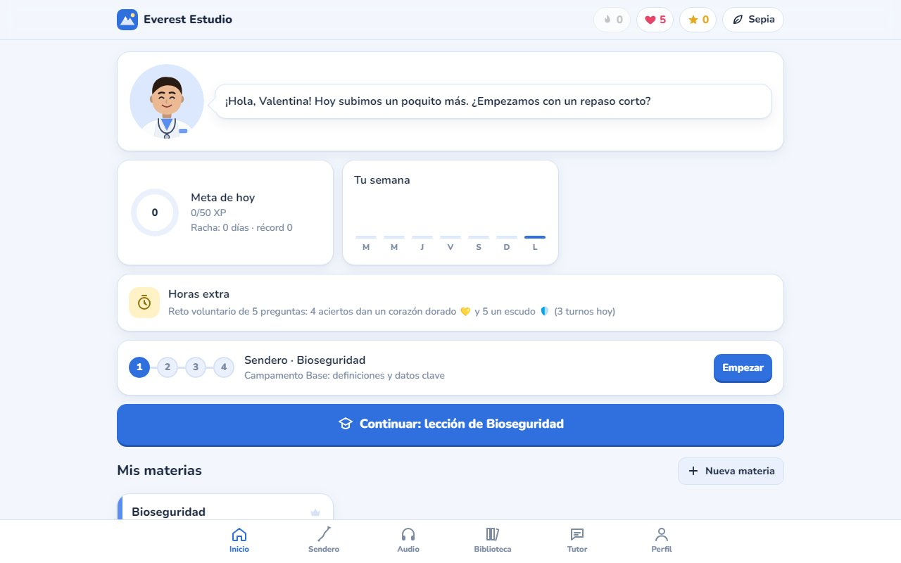
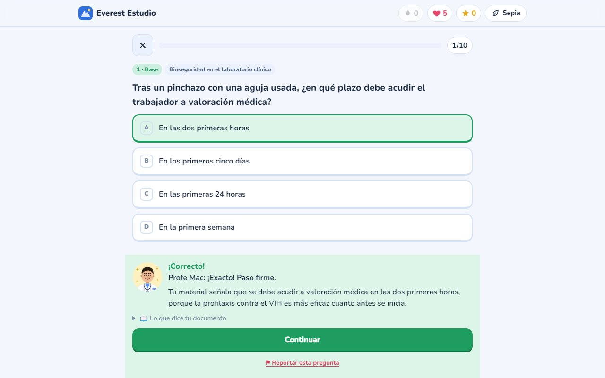
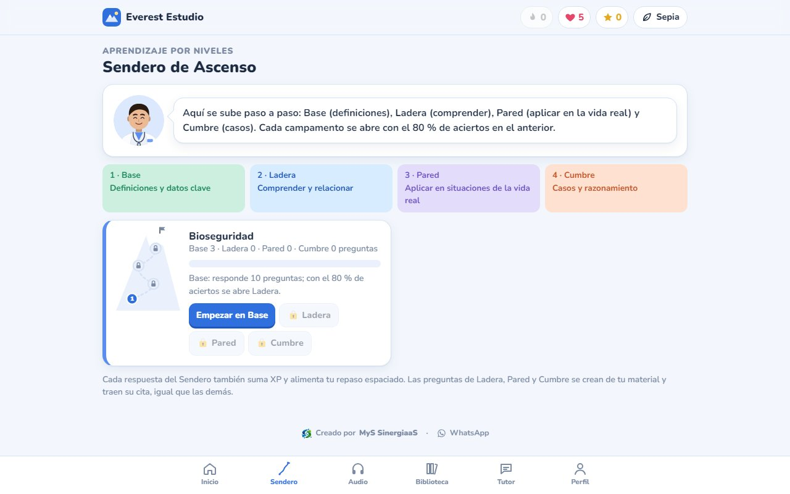
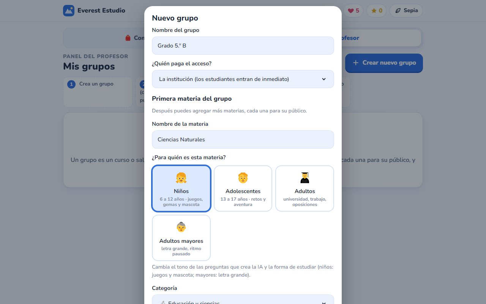
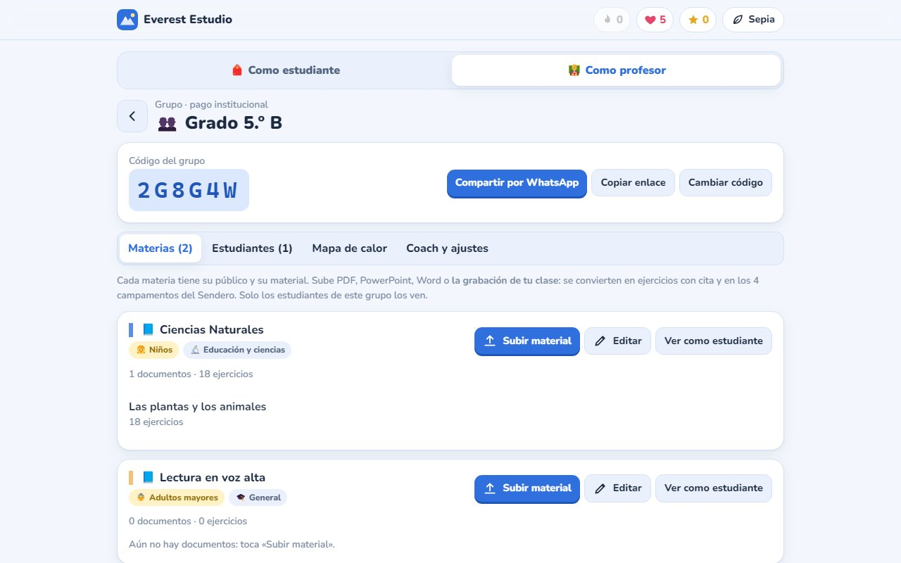
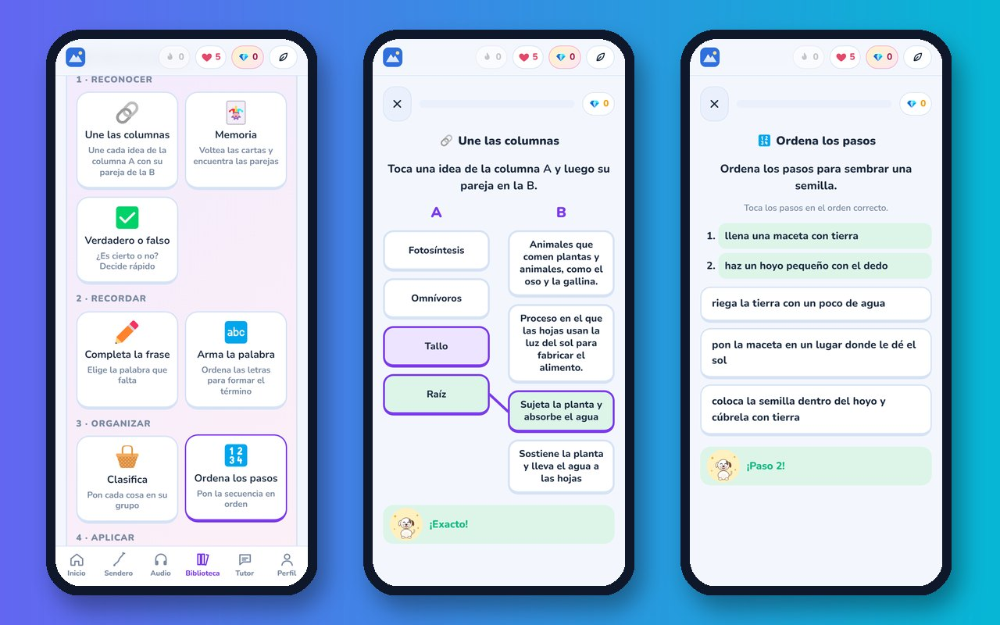
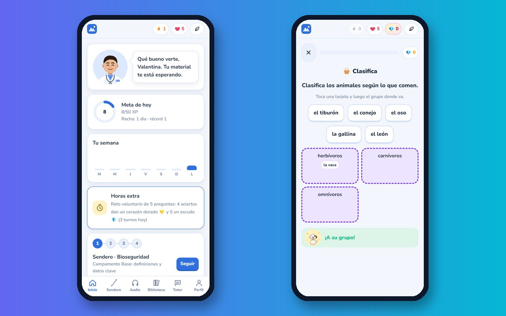

<picture>
  <source media="(prefers-color-scheme: dark)" srcset="assets/mys-logo-blanco.png">
  
</picture>

# 📚 Everest Estudio

### La plataforma donde cada estudiante sube SU material y lo estudia como un juego

**MyS SinergiaaS** — Consultoría y Tecnología
*Automatiza. Escala. Vende.*

`En producción` · `Dominio propio` · `IA con citas verificadas` · `Profesores y grupos` · `Niños, jóvenes, adultos y mayores` · `Funciona sin señal`

---

## El problema

Un estudiante tiene sus apuntes, las guías del profesor y las diapositivas de
clase. Las relee una y otra vez, pero no sabe qué domina de verdad, qué olvidó
ni qué le falta para el examen.

Las aplicaciones de estudio que existen traen **su propio contenido**, no el de
su clase. Y los chats de IA responden rápido, pero a veces inventan, y nadie le
dice al estudiante de qué página salió la respuesta.

## La solución

**Everest Estudio convierte el material de cada estudiante en ejercicios,
niveles y juegos, y cada pregunta trae la cita exacta del documento de donde
salió.**

### Sube tu material, estudia en minutos
PDF, Word, PowerPoint o texto pegado; el profesor también puede subir la
grabación de su clase. En minutos aparecen
ejercicios de opción múltiple, tarjetas de memoria, parejas, casos clínicos o
de la vida real y simulacros cronometrados. El estudiante confirma que tiene
derecho a compartir su material, y el archivo original queda guardado de forma
privada.

### Cada respuesta, con su fuente

El coach explica por qué la respuesta es correcta **con las palabras del
propio documento** y muestra el fragmento citado. Una pregunta que no se puede
respaldar con el material no llega al estudiante. Si algo no le convence,
puede reportarla con un toque.

### El Sendero: de lo básico al caso complejo

Cuatro campamentos: **Base** (definiciones), **Ladera** (comprender y
relacionar), **Pared** (aplicar en la vida real) y **Cumbre** (casos y
razonamiento). Cada uno se abre con el 80 % de aciertos en el anterior, y lo
que se falla vuelve en los días siguientes hasta quedar dominado.

### Para profesores: grupos, materias y públicos

Un profesor crea sus **grupos**, y cada grupo tiene **varias materias**, cada
una para su público: **niños, adolescentes, adultos o adultos mayores**. El
tono de las preguntas, la forma de estudiar y hasta el tamaño de la letra se
ajustan solos. Los estudiantes entran con un código o un enlace de WhatsApp.

El panel del grupo muestra el avance de cada estudiante, un **mapa de calor**
con los temas que más cuestan y el **reporte semanal** para enviar a mamá,
papá, acudiente o patrocinador. El profesor también puede ser estudiante: lo
que enseña y lo que estudia nunca se mezclan.

### Para niños: la Zona de juegos de Everest

En las materias infantiles el coach es **Everest, el perrito explorador**,
que crece con cada campamento. Siete juegos, de lo fácil a lo difícil: **une
las columnas, memoria, verdadero o falso, completa la frase, arma la palabra,
clasifica y ordena los pasos**, con gemas, estrellas e insignias. Todos salen
del material del profesor.

### En el celular, incluso sin señal

Se instala como una app desde el navegador. Sin conexión se sigue estudiando
(Sendero, lecciones, tarjetas, simulacros y audio), y el progreso se sube solo
al volver la señal.

---

## Lo que lo hace distinto

| | |
|---|---|
| 📄 **Tu material, no uno genérico** | Todo se crea a partir de lo que el estudiante o su profesor suben. |
| 🔎 **Citas verificadas** | Cada pregunta trae el fragmento del documento que la respalda. |
| 🏔️ **Por niveles** | De la definición al caso complejo, con repaso de lo que se falla. |
| 🧑‍🏫 **Hecha para el aula** | Grupos, materias, códigos de acceso, mapa de calor y reportes semanales. |
| 👧 **Cuatro públicos** | Juegos y mascota para niños, retos para jóvenes, letra grande para mayores. |
| 🎧 **Para escuchar** | Modo audio para repasar caminando; el profesor puede subir sus clases grabadas con su propia voz. |
| 🧑‍⚕️ **Coach a tu gusto** | «Profe Mac» por defecto, con nombre, apariencia y profesión editables. |
| 📶 **Sin señal** | Instalable en el celular y con estudio sin conexión. |

---

## Caso de éxito

**Piloto en producción con una estudiante de pre-médico.** A partir de sus
propias guías de clase, la plataforma generó **más de 1.000 ejercicios
verificados**, organizados en las cuatro etapas del Sendero, con simulacros y
repaso diario. Ella estudia en el computador y en el celular con el mismo
progreso.

---

## Para quién

- **Estudiantes** de colegio, universidad, preuniversitario y concursos.
- **Profesores e instituciones** que quieren que sus estudiantes practiquen con su material.
- **Campamentos y cursos vacacionales** para niños y jóvenes.
- **Programas para adultos mayores** que necesitan un ritmo pausado y letra grande.

---

## Probarlo

### **→ [estudio.myssinergiaas.com](https://estudio.myssinergiaas.com)**

El acceso es por cuenta. Para una demostración guiada, una cuenta de prueba o
los planes para estudiantes, profesores e instituciones:
**[hablemos por WhatsApp](https://wa.me/573148788974)**.

---

## Modalidades de implementación

| Modalidad | Para quién |
|---|---|
| **Cuenta individual** | El estudiante que estudia su propio material. |
| **Profesor** | Grupos y materias, con sus estudiantes y reportes. |
| **Institución** | Varios profesores, pago centralizado y acompañamiento. |
| **Marca blanca** | El nombre y el dominio de su institución. |

---

## ⚖️ Aviso legal y comercial

> **Este repositorio es una exhibición de portafolio.**
>
> Publica el **resultado** del producto (qué resuelve, cómo se usa y qué
> entrega) con fines comerciales y de demostración de capacidad técnica.
> **No contiene el código fuente de la aplicación.**
>
> El código fuente, el diseño de la dinámica de estudio y los métodos de
> generación y verificación de ejercicios son **propiedad intelectual
> exclusiva de MyS SinergiaaS**. No se distribuyen, licencian ni publican bajo
> ninguna licencia de código abierto.
>
> Las capturas se tomaron con cuentas y material de demostración; no contienen
> datos de estudiantes reales.
>
> Su uso comercial, reventa, ingeniería inversa o incorporación a un producto
> de terceros requiere acuerdo escrito previo.
>
> © 2026 MyS SinergiaaS. Todos los derechos reservados.

---

## Hablemos

**Mac Eduardo Sáenz Martínez**
Dirección de Proyectos · Arquitectura de Soluciones · Transformación Digital
Valencia, Córdoba (Colombia)

